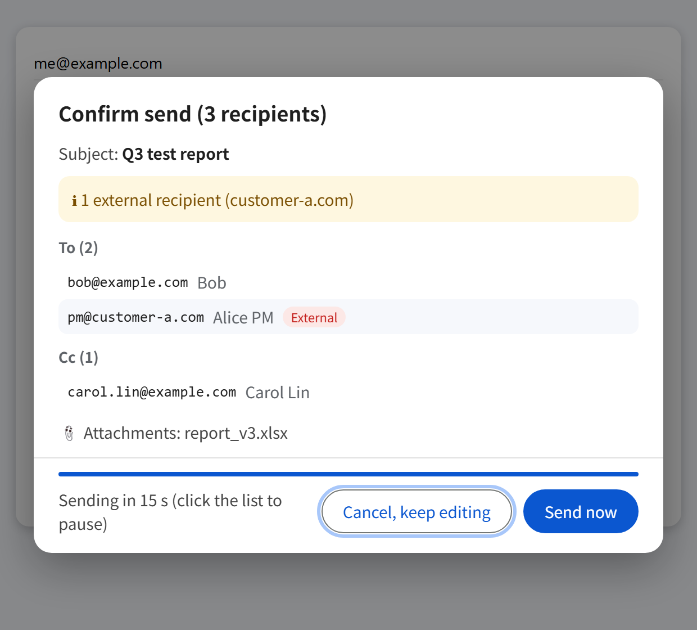
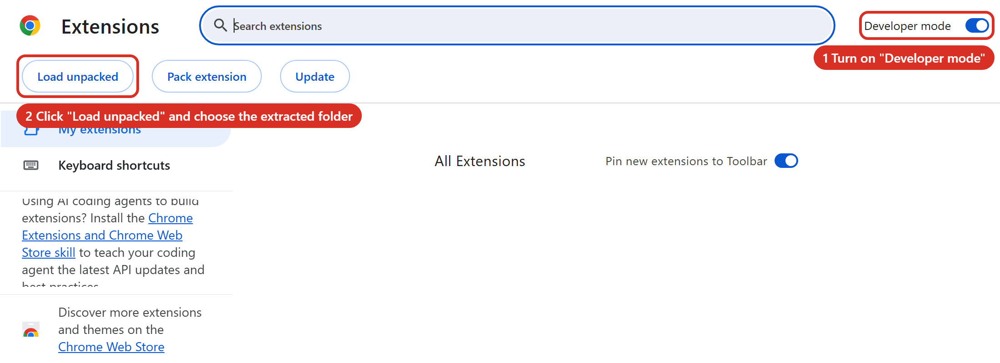
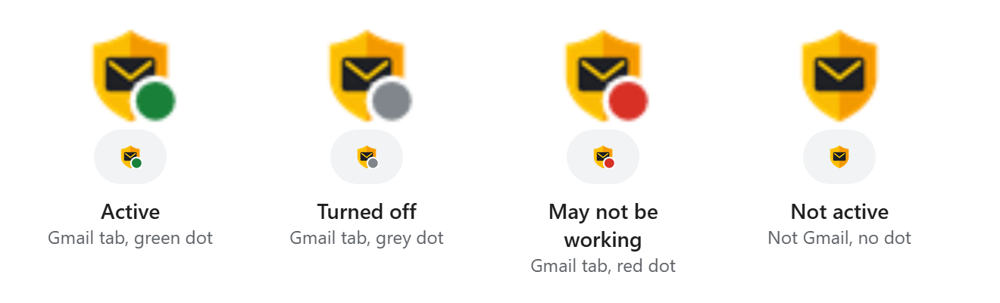
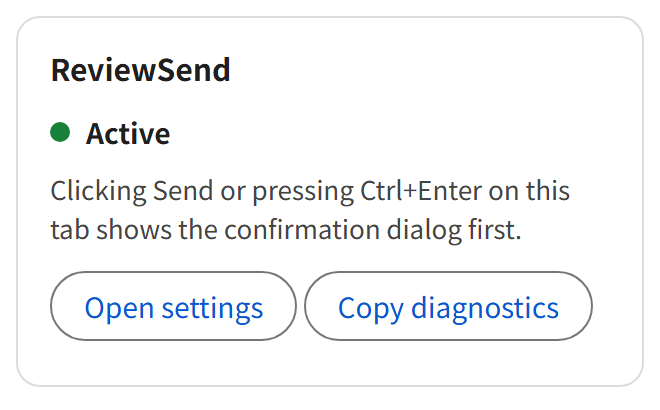
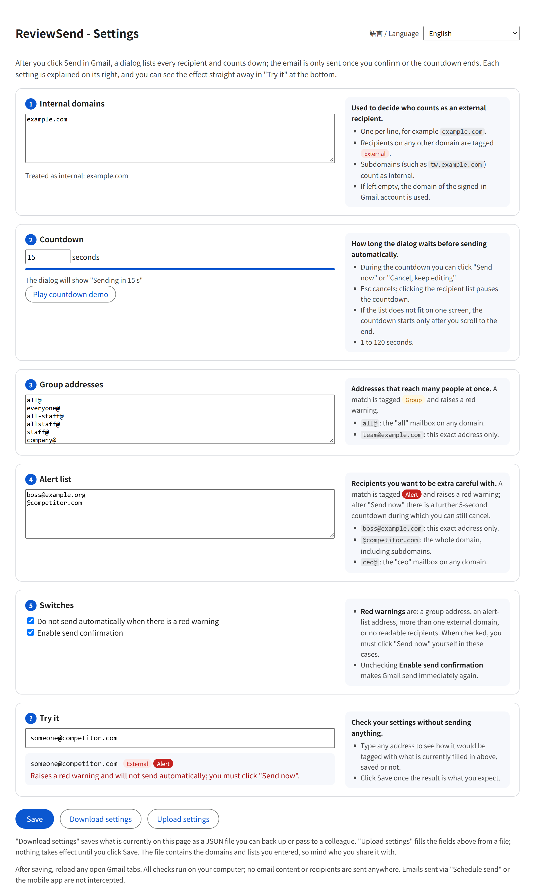
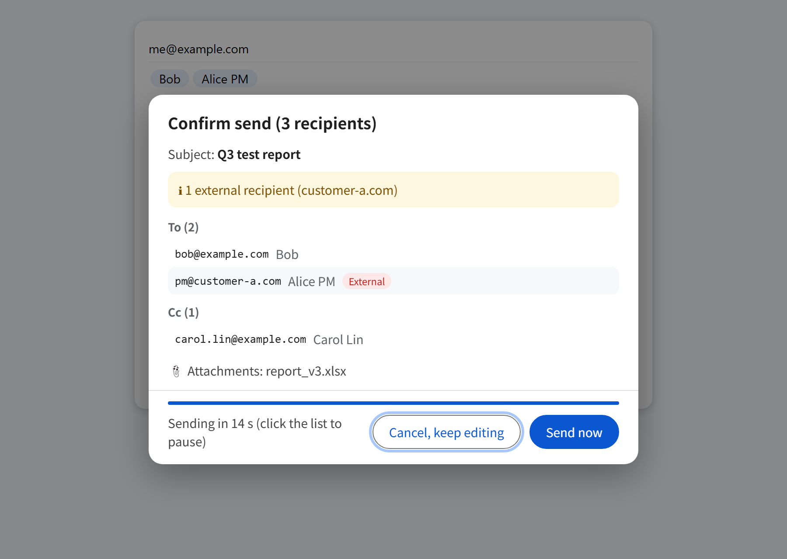
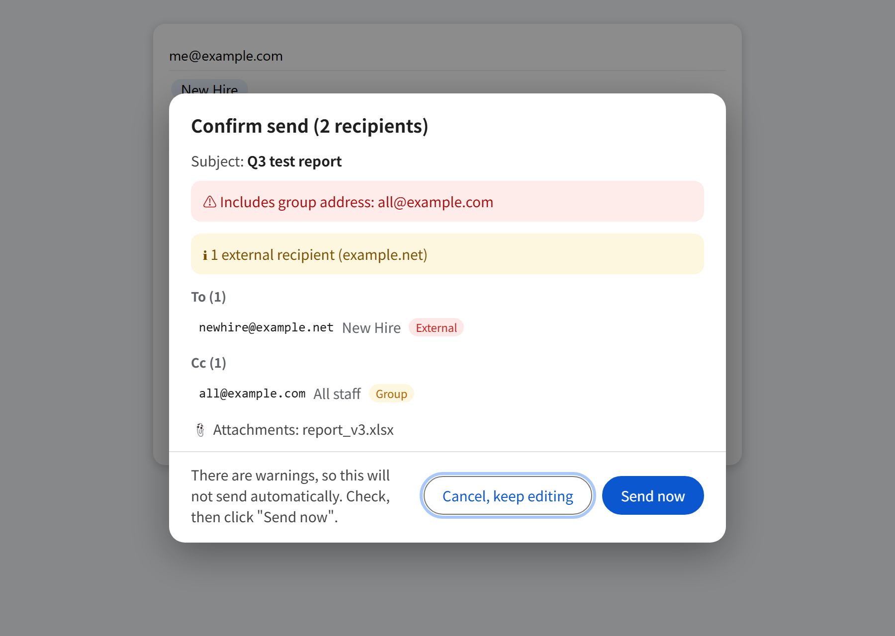
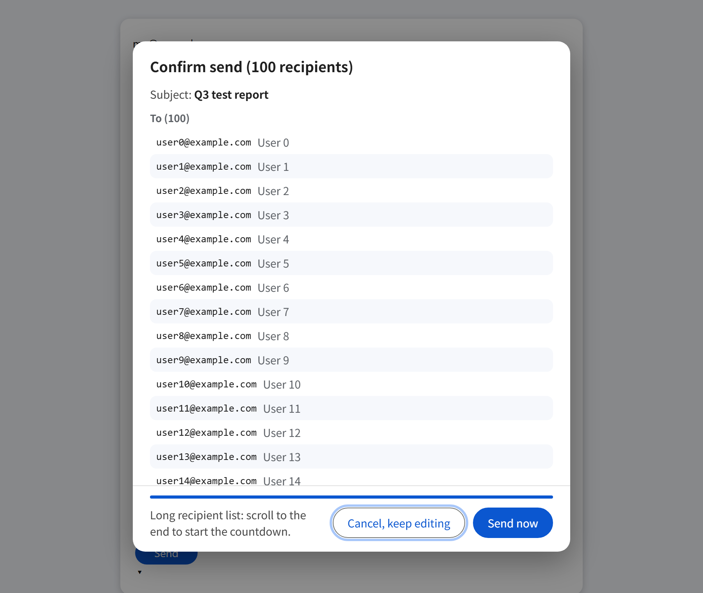

# ReviewSend: Recipient Check for Gmail

**English** | [繁體中文](README.zh-TW.md)

After you click Send in Gmail (or press Ctrl+Enter), a dialog first lists every recipient (To / Cc / Bcc), the subject and the attachments. The email is sent automatically after a 15-second countdown, or you can click "Send now" or "Cancel, keep editing".



- Everything runs locally. It connects to no server and does not read the message body.
- External recipients are tagged "External", group addresses (all@ and the like) are tagged "Group", and addresses on your own list are tagged "Alert".
- When there is a red warning (a group address, an alert-list address, more than one external domain, or no readable recipients) the email is not sent automatically; you have to click "Send now" yourself. This can be turned off in the settings.
- If a recipient is on the alert list, "Send now" starts a further 5-second countdown during which you can still cancel.
- Click anywhere in the list to pause the countdown; Esc cancels.
- If the recipient list does not fit on one screen, the countdown starts only after you scroll to the end. "Send now" still works straight away.
- The interface is available in English and Traditional Chinese. It follows the browser language by default and can be switched in the settings.

> The screenshots here are generated from the sample data in `test/mock_gmail.html`. All addresses and subjects are fictional.

## Install

The extension is not on the Chrome Web Store yet, so it is installed with "Load unpacked".

1. Download this project and extract it. Note where the `extension` folder is.
2. Type `chrome://extensions` in Chrome's address bar and press Enter.
3. Turn on "Developer mode" at the top right (1 in the picture).
4. A row of buttons appears at the top left. Click "Load unpacked" (2 in the picture).

   

5. In the folder picker, choose the `extension` folder inside the project (not the project's top folder).
6. A "ReviewSend" card with a yellow shield icon appears in the list. That means it is installed, and the settings page opens automatically.
7. Finish the steps under "Settings", then **reload any Gmail tabs that are already open**.
8. Pinning the icon is recommended: click the puzzle icon to the right of the address bar, then the pin next to "ReviewSend".

### How to tell it is working

Look for a small dot at the bottom right of the yellow shield icon in the toolbar:



| Icon | Meaning |
|---|---|
| Green dot | This Gmail tab is protected: clicking Send shows the confirmation dialog first |
| Grey dot | "Enable send confirmation" is turned off in the settings, so emails are sent immediately |
| Red dot | May not be working: there is a compose window but Gmail's Send button was not recognised, which usually means Gmail changed. Check your recipients yourself before sending |
| No dot | This tab is not Gmail. If it is Gmail, the tab has not been reloaded since installing or updating |

Click the icon for a description in words, and to open the settings:



The most direct check is to send an email to yourself: if the dialog appears after you click Send, it is working.

To update later: copy the new files over the same folder, click the reload button on the extension's card at `chrome://extensions`, then reload Gmail.

## Settings

The settings page opens automatically on first install. To open it again: click the shield icon, then "Open settings".



"語言 / Language" at the top right switches the interface language (Auto, 繁體中文, English). It takes effect immediately, including in the confirmation dialog.

Each setting has its field on the left and an explanation on the right. Work through them from top to bottom:

1. **Internal domains** (empty by default)<br>
   The part after `@` in your company addresses, one per line. Recipients on any other domain are tagged "External".
   If left empty, the domain of the signed-in Gmail account is used.
2. **Countdown** (15 by default)<br>
   How many seconds the dialog waits before sending, from 1 to 120.
   "Play countdown demo" shows what it looks like.
3. **Group addresses** (all@, everyone@, all-staff@, allstaff@, staff@ and company@ by default)<br>
   Addresses that reach many people at once.
   - `all@`: the "all" mailbox on any domain
   - `team@example.com`: this exact address only
4. **Alert list** (empty by default)<br>
   Recipients you want to be extra careful with.
   - `boss@example.com`: this exact address only
   - `@example.com` or `example.com`: the whole domain, including subdomains
   - `ceo@`: the "ceo" mailbox on any domain
5. **Switches** (both on by default)<br>
   - Do not send automatically when there is a red warning
   - Enable send confirmation

When you are done:

1. Type any address into "Try it" at the bottom and check that it is tagged Internal, External, Group or Alert as you expect. This sends nothing and does not need saving first.
2. Click "Save".
3. Reload your Gmail tabs.

### Sharing settings with other people

At the bottom of the settings page are "Download settings" and "Upload settings":

- "Download settings" saves what is currently on the page as `reviewsend-config.json`.
- Someone else can install the extension, click "Upload settings" and pick that file. The fields are filled in, and nothing takes effect until they click "Save".
- The file contains your company domains and lists, so do not put it anywhere public. The language choice is not included.

## For IT administrators: managed settings (optional)

This section is optional. With nothing configured, the extension behaves exactly like a personal install and everyone uses their own settings.

The extension supports Chrome's managed storage. Once an administrator pushes settings:

- **Internal domains, group addresses, alert list**: merged with the user's own. Users can add more but cannot remove the administrator's entries.
- **Countdown, "do not send automatically when there is a red warning"**: the administrator's value wins and the field is locked on the settings page.
- **Force enabled**: with `forceEnabled` set to `true`, users cannot turn send confirmation off.
- Anything not pushed is still up to the user.

On the settings page, managed entries are shown in blue as "Set by your administrator".

Outline:

1. The extension needs a fixed ID first, which means publishing it to the Chrome Web Store (unlisted or restricted to your organisation is fine) or hosting your own update source.
2. In the Google Workspace admin console, under Chrome apps and extensions, add the extension by its ID and set it to force-install.
3. Paste JSON into the extension's policy field. See [docs/policy-example.json](docs/policy-example.json) for an example; the available keys are defined in `extension/managed_schema.json`.
4. On a user's Chrome, `chrome://policy` shows the values the extension received.

Menu locations and formats in the admin console may change as Google updates it, so follow the current admin documentation. This feature has only been tested with simulated managed settings, not in a real Workspace environment.

## What you see when sending

Write your email as usual and click Send or press Ctrl+Enter. The email is not sent straight away; the confirmation dialog appears first.

### Normal case: sent automatically after the countdown



- The top shows the number of recipients and the subject, followed by every address grouped under To / Cc / Bcc.
- External recipients have a red "External" tag, and the yellow box lists the external domains.
- The blue bar and the text at the bottom show the seconds left. The email is sent when the countdown ends.
- "Send now" skips the countdown. "Cancel, keep editing" or Esc sends nothing and returns to the compose window.
- Click the recipient list to pause the countdown and take your time.

### Red warning: not sent automatically



In any of these cases there is a red warning at the top, no countdown, and you have to click "Send now" yourself after checking:

- A recipient is a group address.
- A recipient is on the alert list.
- The email goes to two or more different external domains.
- No recipients could be read (usually because Gmail's layout changed).

If a recipient is on the alert list, "Send now" does not send immediately: it counts down another 5 seconds, with the seconds shown on the button. "Cancel, keep editing" or Esc during those 5 seconds stops it. For the other red warnings (such as a group address) "Send now" sends immediately.

### Many recipients: scroll to the end first



When the list is taller than the dialog, the countdown does not start and the text at the bottom asks you to scroll to the end. The countdown starts once you reach the bottom. If you would rather not wait, "Send now" works at any time.

## Project layout

```
reviewsend/
├── extension/          ← the Chrome extension itself (load this folder)
│   ├── manifest.json
│   ├── managed_schema.json  ← the settings an administrator can push
│   ├── background.js   ← opens the settings on first install, draws the status dot on the toolbar icon
│   ├── content.js      ← intercepts Send, reads recipients, shows the dialog
│   ├── i18n.js         ← interface text (English / Traditional Chinese)
│   ├── _locales/       ← the extension description per language
│   ├── icons/
│   ├── options.html / options.js   ← settings page
│   └── popup.html / popup.js       ← status popup for the toolbar icon
├── docs/               ← user guide, screenshots (Chinese ones in images/, English in images/en/), policy example
├── scripts/
│   └── package.py      ← checks and builds the installable zip
├── test/
│   ├── mock_gmail.html ← a mock Gmail compose window
│   └── run_test.py     ← Playwright tests (47 checks)
└── .github/workflows/release.yml  ← tests, packages and publishes when a version tag is pushed
```

## Tests

```
pip install playwright
playwright install chromium
python test/run_test.py
```

The tests use the mock page to check: the dialog opens on Send, automatic send after the countdown, send now, cancel, Ctrl+Enter, Esc, group and multi-domain warnings, pausing by clicking the list, the "more send options" menu not being intercepted, scrolling to the end for long lists, the English interface, and switching languages. A full run takes about 2.5 minutes.

If your computer's security settings do not allow Playwright's downloaded Chromium to run, use an installed browser instead: set the `CHROME_PATH` environment variable to the Edge executable before running. Recent versions of Google Chrome do not allow loading an extension from the command line, so Chrome cannot be used for these tests.

## Packaging and releasing

### Build on your own computer

```
python scripts/package.py
```

This writes `reviewsend-<version>.zip` to `dist/`, with the version taken from `extension/manifest.json`. The zip can be handed to someone to install, and is also what you upload to the Chrome Web Store. Only Python is needed, with no extra packages. The same source always produces an identical file.

Checks run first, and nothing is written if any of them fails:

- The version is well formed, every file named in `manifest.json` exists, and there is a 128×128 icon.
- The name, short name and description (in every language) are within the store's length limits.
- The only permission is `storage` and the extension only runs on `mail.google.com`. Adding a permission later means editing the allow-list in `scripts/package.py` as well, so it cannot slip in by accident.
- The code contains no network calls or dynamic code execution, and the pages load no remote resources. This is the automatic guard behind "all checks run on your computer".
- There are no unexpected file types in `extension/`.

To check without writing a file: `python scripts/package.py --check`

### Releasing a new version

1. Change `version` in `extension/manifest.json` (the store requires each upload to have a higher version than the last), then commit and push.
2. Create a tag with the same version and push it:

   ```
   git tag -a v1.1.0 -m "ReviewSend 1.1.0"
   git push origin v1.1.0
   ```

3. GitHub runs the tests, builds the zip, and creates the release on the Releases page with the zip attached. If the tag and the version in `manifest.json` differ, or the tests fail, nothing is published.

You can also run the "Release" workflow by hand from the Actions page on GitHub. It does the same checks and builds the zip, which is kept as an artifact of that run without publishing anything.

## Limitations

- It only works on Gmail in desktop Chrome. The mobile apps are not intercepted.
- It recognises the Send button and the recipients from Gmail's page structure, so a Gmail redesign may break it. There are two safeguards: if no recipients can be read, a red warning is shown and nothing is sent automatically; if the Send button is not recognised, the toolbar icon shows a red dot.
- The Send button is recognised by any of three features (Gmail's class name, the button label in several languages, and the Ctrl-Enter shortcut in its tooltip), so it works even when Gmail's interface language is not in the built-in list.
- Emails sent from the "Schedule send" menu are not intercepted.
- After the countdown ends and the email is sent, Gmail's own "Undo send" still works.

## License

This project is released under the [MIT License](LICENSE). The software is provided as is, without warranty of any kind. You are responsible for checking your recipients, and the author is not liable for losses caused by misdirected emails.
