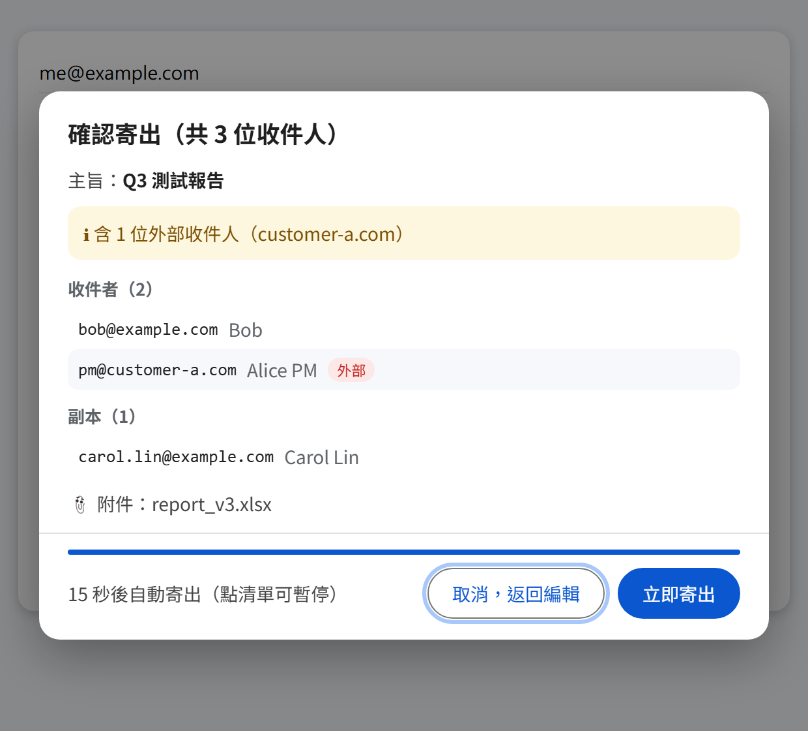
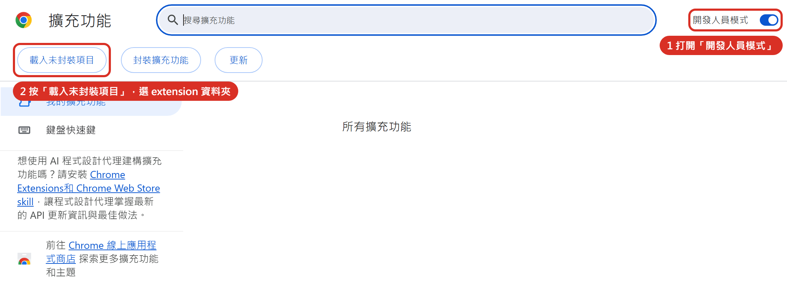
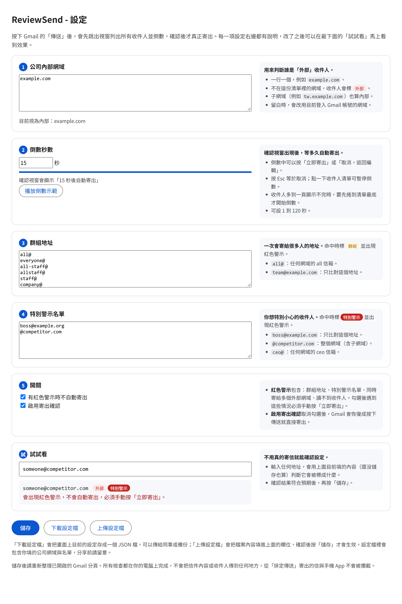
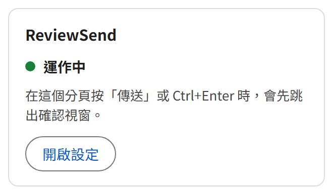
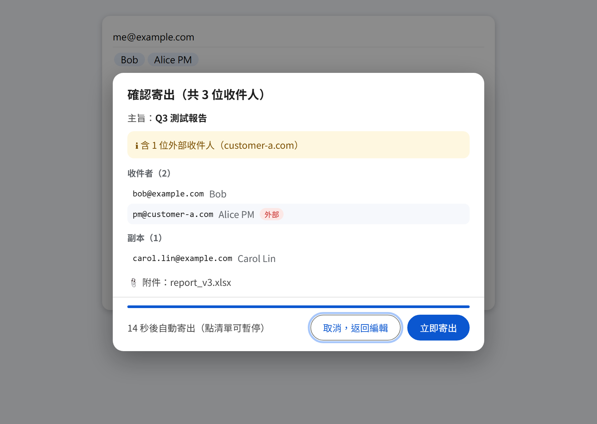
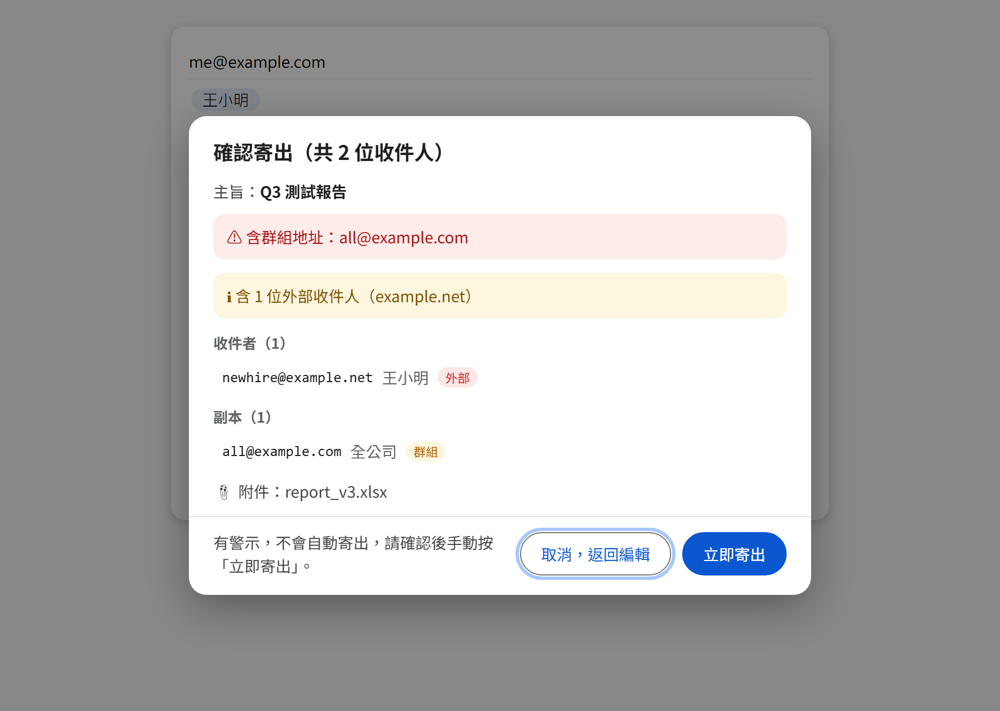
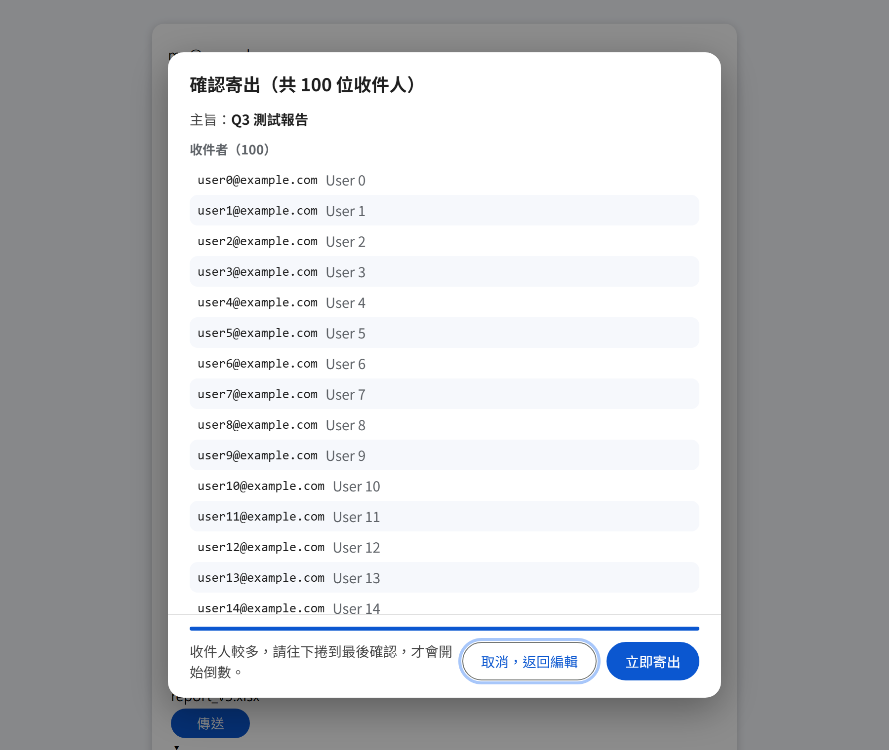

# ReviewSend 使用手冊

這份手冊給實際使用的人看，不需要懂程式。照著做大約 5 分鐘可以完成安裝與設定。

## 1. 這是什麼

ReviewSend（完整名稱 ReviewSend: Recipient Check for Gmail）是一個 Chrome 擴充套件。裝好之後，你在 Gmail 按下「傳送」時，信不會馬上寄出，而是先跳出一個視窗，把這封信的所有收件人、主旨和附件列給你看，倒數幾秒後才真正寄出。

它幫你避免這些情況：

- 收件人打錯，或自動完成選到同名的另一個人。
- 不小心把公司內部的信寄給外部的人。
- 不小心寄給全公司的群組信箱。
- 同一封信同時寄給兩家不同的客戶。

它不會做這些事：

- 不會把你的信件內容或收件人傳到任何地方，所有檢查都在你自己的電腦上完成。
- 不會修改你的信。
- 不會擋住你寄信，任何時候都可以按「立即寄出」。

## 2. 安裝

你會拿到一個壓縮檔 `reviewsend-x.x.x.zip`。

1. 把壓縮檔解壓縮到一個固定的資料夾，例如「文件」底下。**安裝後這個資料夾不能刪除或搬走**，否則擴充套件會失效。
2. 打開 Chrome，在網址列輸入 `chrome://extensions` 後按 Enter。
3. 打開頁面右上角的「開發人員模式」開關（下圖 1）。
4. 按左上角出現的「載入未封裝項目」（下圖 2）。

   

5. 在跳出的視窗中，選剛才解壓縮出來的資料夾，按「選擇資料夾」。
6. 頁面上出現黃色盾牌圖示的「ReviewSend」卡片，就是安裝成功。這時會自動開啟設定頁。
7. 按網址列右邊的拼圖圖示，在「ReviewSend」旁邊按圖釘，把它固定在工具列上，方便之後查看狀態。

> 之後每次開啟 Chrome，可能會看到「停用開發人員模式擴充功能」的提醒，按關閉即可，不要按停用。

## 3. 第一次設定

安裝後會自動開啟設定頁。之後想再打開，點工具列上的盾牌圖示，再按「開啟設定」。

### 最快的方式：使用別人給你的設定檔

如果同事或 IT 給了你一個 `reviewsend-config.json`：

1. 在設定頁最下面按「上傳設定檔」，選那個檔案。
2. 確認上方的欄位已經自動填好。
3. 按「儲存」。

### 自己設定

只有第 1 項一定要確認，其他用預設值就可以。

1. **公司內部網域**：填公司信箱 `@` 後面的部分，例如信箱是 `name@example.com` 就填 `example.com`。這是用來判斷誰是「外部」收件人。留白的話，會自動使用你登入 Gmail 的帳號網域。
2. **倒數秒數**：確認視窗出現後等幾秒自動寄出，預設 15 秒。
3. **群組地址**：一次會寄給很多人的信箱，預設已包含 `all@`、`staff@` 等常見的名稱。公司有其他群組信箱可以加進來。
4. **特別警示名單**：你想特別小心的收件人或網域，預設是空的。
5. **開關**：建議兩項都保持勾選。

填好之後：

1. 在「試試看」輸入幾個地址（例如同事的、客戶的），看結果是不是你預期的。這一步不會寄信。
2. 按「儲存」。
3. **回到 Gmail 分頁，按重新整理**。沒有重新整理的話，設定不會生效。

## 4. 確認有在運作

打開 Gmail，看工具列上的盾牌圖示右下角：

| 圖示 | 代表 | 你該做什麼 |
|---|---|---|
| 綠色圓點 | 運作中 | 不用做什麼 |
| 灰色圓點 | 已停用 | 到設定頁勾選「啟用寄出確認」並儲存 |
| 紅色圓點 | 可能失效 | 寄信前請自己仔細確認收件人，並通知提供這個套件的人 |
| 沒有圓點 | 這個分頁沒有作用 | 如果這是 Gmail 分頁，按重新整理 |

點一下盾牌圖示，也會用文字告訴你目前的狀態：

最直接的確認方法：寄一封信給自己。按「傳送」後有跳出確認視窗，就是正常。

## 5. 日常使用

照平常的方式寫信，按「傳送」或 Ctrl+Enter，就會看到確認視窗：

請看這幾個地方：

- **標題的收件人總數**：和你預期的人數一樣嗎？
- **收件者、副本、密件副本**：每個地址都是你要寄的人嗎？
- **紅色的「外部」標籤**：這些人不是公司內部的，確定要寄給他們嗎？
- **主旨和附件**：有沒有忘記附檔，或附錯檔案？

接下來你可以：

| 你想做的事 | 操作 |
|---|---|
| 確認沒問題，讓它自己寄出 | 什麼都不用按，倒數結束就寄出 |
| 不想等 | 按「立即寄出」 |
| 發現有問題，要回去修改 | 按「取消，返回編輯」，或按鍵盤的 Esc |
| 想慢慢檢查，不要倒數 | 在收件人清單上點一下，倒數會暫停 |

取消之後信不會寄出，會回到撰寫視窗，內容都還在。

## 6. 出現紅色警示時

視窗上方出現紅色區塊時，**不會倒數，也不會自動寄出**。你必須看過之後，自己按「立即寄出」或「取消，返回編輯」。

會出現紅色警示的情況：

| 警示內容 | 意思 | 建議 |
|---|---|---|
| 含群組地址 | 收件人裡有群組信箱，會寄給很多人 | 確認真的要寄給整個群組 |
| 含特別警示地址 | 收件人在你的特別警示名單裡 | 再確認一次內容和附件。按「立即寄出」後還會再倒數 5 秒，這段時間可以按「取消，返回編輯」反悔 |
| 同時寄給多個不同的外部網域 | 這封信同時寄給兩家以上的外部單位 | 確認沒有把甲客戶的信也寄給乙客戶 |
| 讀不到任何收件人 | 套件看不懂目前的 Gmail 畫面 | 自己到撰寫視窗確認收件人；並通知提供這個套件的人 |

## 7. 收件人很多時

收件人多到視窗一頁顯示不完時，倒數不會開始，下方會提示你先往下捲。把清單捲到最底之後才開始倒數，確保你看過每一個收件人。

如果你確定沒問題、不想捲，也可以直接按「立即寄出」。

## 8. 常見問題

**按了傳送，沒有跳出確認視窗，信直接寄出去了。** 
先看盾牌圖示的狀態（第 4 節）。最常見的原因是安裝或更新後沒有重新整理 Gmail 分頁。另外，從「排定傳送」寄出的信不會被攔截。

**信已經寄出去了才發現有問題，怎麼辦？** 
Gmail 本身的「取消傳送」仍然有效。信寄出後，畫面左下角會短暫出現「取消傳送」，在它消失之前按下去就能收回。可以在 Gmail 的設定裡把取消傳送的時間調到最長 30 秒。

**盾牌圖示出現紅色圓點。** 
代表 Gmail 的畫面可能改版了，套件認不出傳送按鈕，這時信可能會直接寄出而不會跳視窗。寄信前請自己仔細確認收件人，並通知提供這個套件的人。

**這個套件會看到我的信件內容嗎？** 
它只讀取撰寫視窗裡的收件人、主旨和附件檔名，用來顯示在確認視窗上。這些資料不會離開你的電腦，套件沒有任何連線到外部的功能。

**我想暫時關掉它。** 
到設定頁取消勾選「啟用寄出確認」並儲存，圖示會變成灰色圓點。要恢復時再勾回來。如果這個選項是灰色不能改，代表是公司的 IT 統一設定的。

**每次都要等 15 秒，太久了。** 
可以到設定頁把倒數秒數改短，或者每次確認後直接按「立即寄出」。不建議設得太短，否則會來不及看。

**有些設定欄位是灰色的，旁邊寫「由管理員設定」。** 
這是公司 IT 統一下發的設定，你不能修改或移除，但名單類的欄位你仍然可以再加自己的項目。

**我在手機上寄信，會有確認視窗嗎？** 
不會。這個套件只對電腦版 Chrome 上的 Gmail 網頁有效，手機 App 不受保護。

**我有兩個 Chrome 使用者設定檔（例如工作和個人）。** 
每個設定檔要各自安裝、各自設定一次。

**怎麼更新到新版？** 
把新版壓縮檔解壓縮，覆蓋到原本的資料夾，再到 `chrome://extensions` 按「ReviewSend」卡片上的重新載入按鈕，最後重新整理 Gmail 分頁。你的設定會保留。

**怎麼移除？** 
到 `chrome://extensions`，在「ReviewSend」卡片上按「移除」。

## 9. 快速參考

| 情況 | 會發生什麼 |
|---|---|
| 一般的信 | 列出收件人，倒數後自動寄出 |
| 有外部收件人 | 標示「外部」並提示，仍會倒數後自動寄出 |
| 有群組地址、特別警示地址，或多個外部網域 | 紅色警示，不自動寄出，要手動按 |
| 收件人一頁顯示不完 | 捲到最底才開始倒數 |
| 按 Esc 或「取消，返回編輯」 | 不寄出，回到撰寫視窗 |
| 按「立即寄出」 | 馬上寄出 |
| 排定傳送、手機 App | 不會被攔截 |
